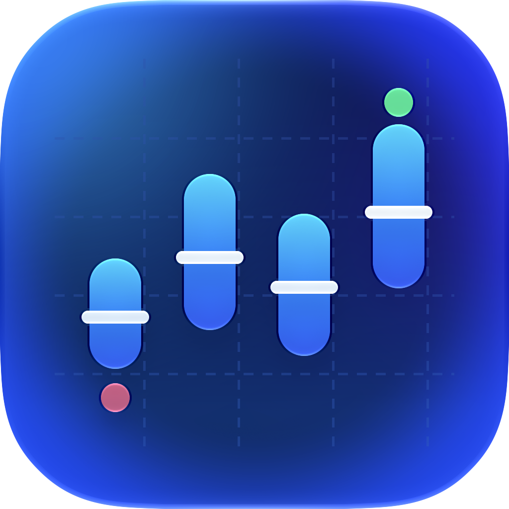
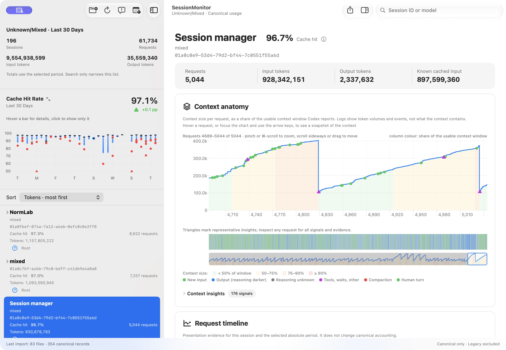

  

<h1 align="center">SessionMonitor</h1>

<strong>Understand your Codex sessions. Catch waste while you can still act.</strong>

  A native macOS app that turns local Codex logs into clear token usage, 
  cache performance, context timelines, and actionable signals.

  <a href="https://github.com/SoundBlaster/SessionMonitor/releases/latest"><strong>Download for macOS</strong></a>
  · <a href="docs/getting-started.md">Getting started</a>
  · <a href="docs/cli.md">CLI guide</a>

macOS 15+ · Apple silicon &amp; Intel · Free &amp; open source

*Real session data, imported on October 23, 2026. Shown in a development build; the latest release may look slightly different.*

## Fast answers for your agent

**`180 ms` to check your session. About `32 MiB` peak RAM.**

*Development build (SM-749). These measurements are not for the latest published release.*

| CLI operation | Median response | Peak CLI memory |
| --- | ---: | ---: |
| Latest session status, 24-hour lookback | `180 ms` | `31.9 MiB` |
| Selected session, 7-day lookback | `680 ms` | `52.3 MiB` |
| Account quota summary | `50 ms` | `23.0 MiB` |

Measured on October 25, 2026 with the Release arm64 CLI on Apple M4 Pro, 24 GiB RAM,
macOS 27: **85,000+ source usage records** and **319,000+ raw quota observations**.
Ten fresh-process repetitions after database initialization; memory is peak process RSS.
Results depend on hardware and data. [Benchmarks and methodology →](https://github.com/SoundBlaster/SessionMonitor/blob/8097a8b98a8691e85fb2441d4016b9b926320a52/docs/performance/SM-749-bounded-agent-status.md)

## Keep the big picture. Inspect the details.

A long-running agent can make thousands of requests before you notice a pattern. SessionMonitor
helps you see which sessions drive token volume, how effectively the cache is used, and when
context growth, repeated waits, or unusual activity deserve a closer look.

**Start with the overview. Follow the evidence down to the request.**

| What you want to know | What you can see |
| --- | --- |
| Where are my tokens going? | Input, output, and known cached input by session and model, with root/subagent relationships and sortable sessions. |
| Is the cache working? | Weighted cache hit rate, typical ranges, and outliers. Switch from a month to today’s hourly view, or open the larger interactive chart. |
| Why is this session getting so large? | Context anatomy across requests, with compactions, human turns, token composition, and an inspectable request snapshot. |
| How large are my session logs? | Imported source size in bytes, with explicit unknown/partial coverage and separate subagent files. |
| What changed while I was working? | Folder watching, incremental imports, diagnostic findings, and macOS alerts for supported signals. |
| What do the logs say about my quota? | Observed usage windows, reset times, freshness, and account-specific coverage, with unknown data clearly identified. |

## Built for the way you work

- **Zoom into the moment.** Pan and zoom dense charts, inspect a request, or click a cache interval to narrow the session list and totals.
- **Stay in flow.** Check a compact menu bar summary or a desktop widget. Let Watch keep the index current while you work.
- **Keep accounts separate.** Use a shared account and period selector across the app and menu bar. Quota windows stay grouped by profile.
- **Give agents the same visibility.** A standalone CLI exposes reports, findings, snapshots, and alerts. Optional hooks can add relevant alerts to an agent’s context.
- **Share a reproducible case.** Export an anonymized session fixture for diagnostics without sending the original transcript.

## Numbers you can reason about

Copied fork history should not count twice. Missing data should not look like zero.
SessionMonitor applies ownership and deduplication rules, preserves unknown values, and links
findings to evidence and limitations.

Cache hit rate is **cached input ÷ input**. It describes cache usage, not a dollar saving.
Quota comes from observations in your logs, not a live billing connection. A signal is a reason
to investigate, not proof of its cause. [How the data is interpreted →](docs/data-and-coverage.md)

## Privacy

**Local analysis. No telemetry uploads. No cloud account or API key required.**

- **Your files stay yours.** SessionMonitor reads the local Codex folders you import or watch,
  plus the optional chat-title index. It does not modify the source logs or upload them to
  OpenAI, the developer, or an analytics service. Quota is read from imported observations;
  the app does not contact a billing API.
- **Metadata stays local.** The SQLite index stores token counters, timestamps, model names,
  session titles/IDs, source paths, account/profile metadata, and diagnostic events. It does
  not retain prompt bodies, assistant responses, or tool output as a transcript. Account
  attribution uses explicit log metadata or your mappings, not `auth.json`, cookies, or API keys.
- **Widgets receive aggregates.** The app shares a local App Group snapshot with its widget
  extension, containing usage/cache statistics, periods, and timezone—not session names, IDs,
  model names, or source paths.
- **Sharing is your choice.** Anonymized JSON export removes session/account identifiers,
  titles, paths, and absolute timestamps. It retains models/client version, token counts,
  relative request timing, and event counts. Review it before sharing: activity patterns can
  still be recognizable. Export saves a file; it does not upload it automatically.

The local database, ordinary CLI reports, screenshots, and notifications can expose metadata.
Optional agent hooks add alerts to the receiving agent’s context; that agent’s own data-handling
policy then applies. [More about local data and exports →](docs/data-and-coverage.md#local-data-and-exports)

## From download to insight

1. [Download the latest release](https://github.com/SoundBlaster/SessionMonitor/releases/latest), open the DMG, and move **SessionMonitor** to **Applications**.
2. Open the app and import **`~/.codex/sessions`** to include sessions across years. You can also choose a single year or another log folder.
3. Choose a period and explore a session. Start **Watch Folder…** from the menu bar when you want ongoing updates.

The macOS download is signed with Developer ID and notarized. A separate CLI archive is
available on the same release page. See [installation and first run](docs/getting-started.md)
for widget setup, updates, and troubleshooting.

## Go further

| Guide | Use it for |
| --- | --- |
| [App guide](docs/app-guide.md) | Account scopes, period filters, chart gestures, findings, menu bar, and widgets. |
| [CLI guide](docs/cli.md) | Imports, reports, profiles, quota, alerts, JSON snapshots, and exports. |
| [Watching & troubleshooting](docs/watching.md) | Continuous imports, pause/resume, changed files, and database ownership. |
| [Agent integration](docs/agent-integration.md) | Codex / Claude Code hooks and script-friendly session status. |
| [Development](docs/development.md) | Build from source, signing, generated Xcode projects, and quality checks. |
| [Releasing](docs/releases.md) | Developer ID distribution, notarization, and App Store Connect uploads. |

Built with Swift, SwiftUI, and a shared core for the app and CLI.
[Contributions](CONTRIBUTING.md), [roadmap](ROADMAP.md), and [architecture](monitor-design.md)
are available in the repository. The CLI also builds on Linux; the app, widgets, and macOS
notifications require macOS.

[MIT License](LICENSE) · [Third-party notices](THIRD_PARTY_NOTICES.md)
